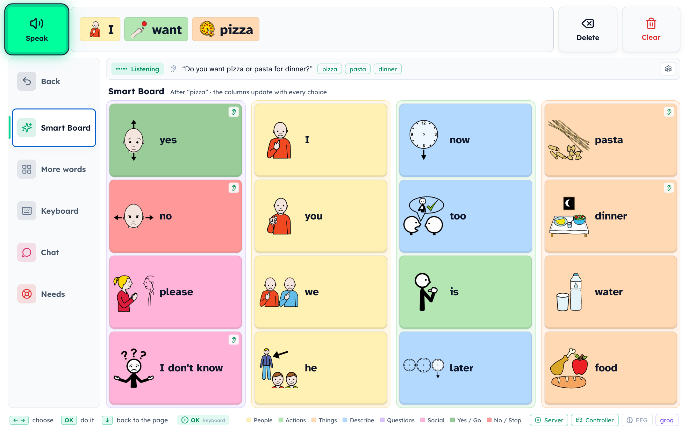
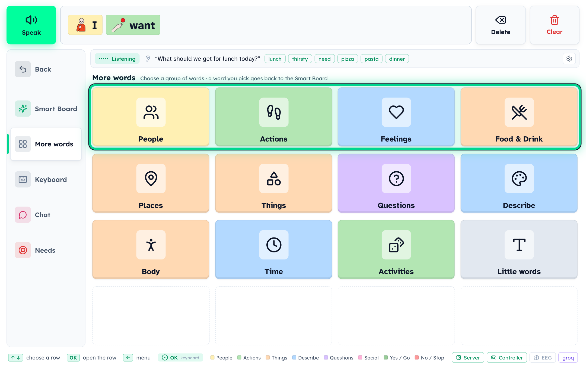
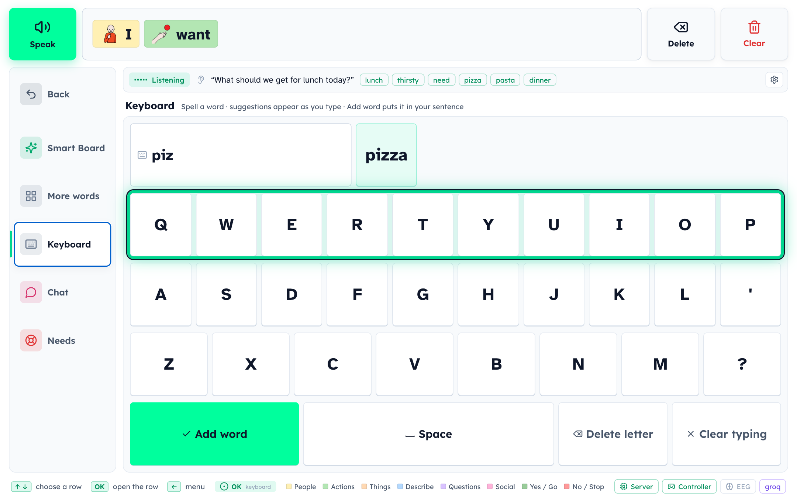
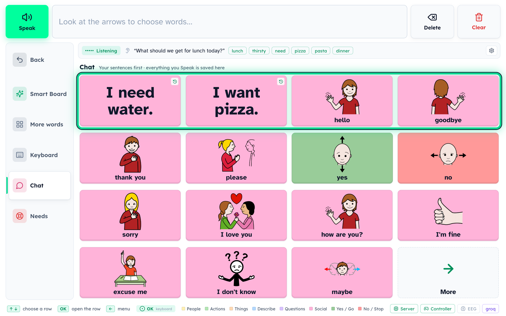
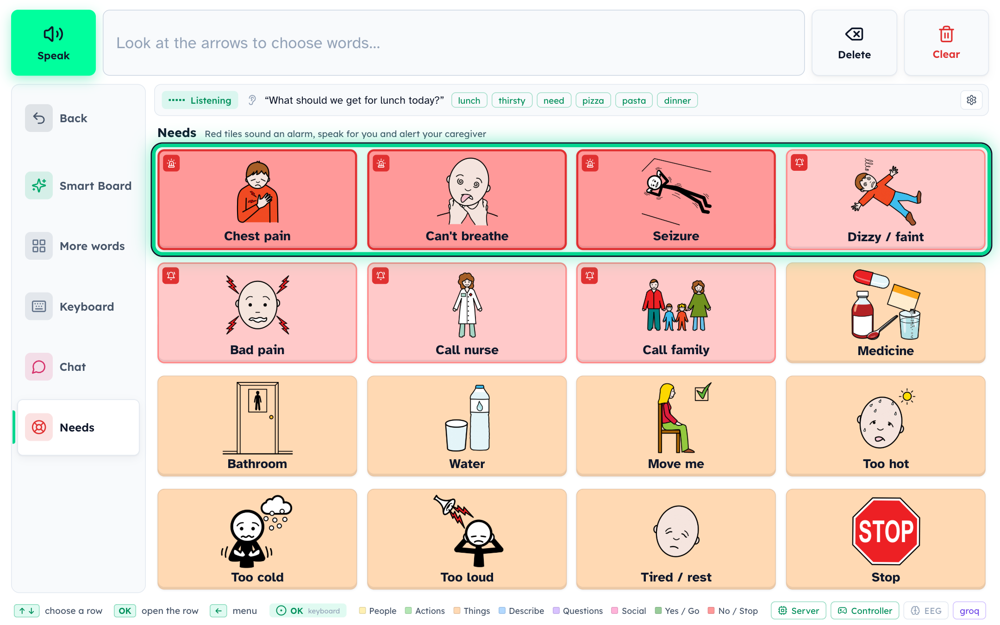
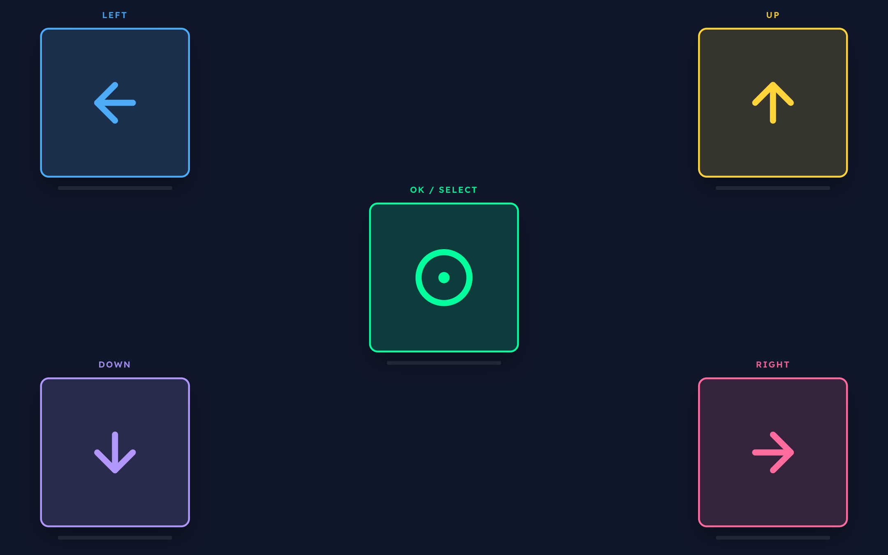
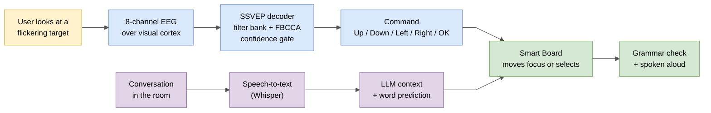
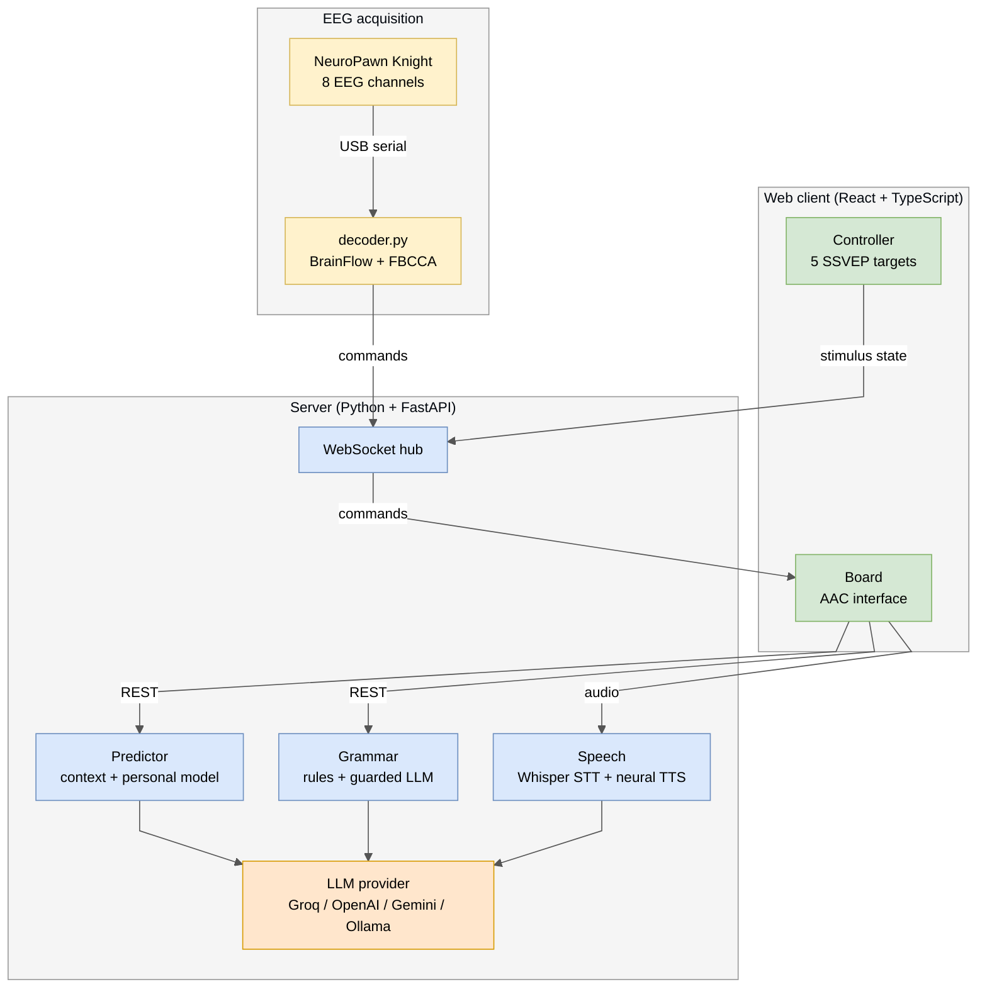

<div align="center">

# AdaptiBoard

**A brain-computer interface for people who cannot speak or move.**<br/>
Users build sentences by looking at on-screen targets, and the board adapts to the conversation around them.


</div>

---

## The problem

People with ALS, locked-in syndrome, brainstem stroke, cerebral palsy or high spinal-cord injury often keep full awareness and plenty to say, but lose the ability to speak, type or point. They depend on augmentative and alternative communication (AAC), and today's options leave large gaps:

| Gap | What it means for the user |
|---|---|
| **Communication is slow** | AAC users often produce under 15 words per minute, while spoken conversation runs at about 150. By the time a reply is built, the conversation has moved on. |
| **Boards are static** | A fixed grid shows the same words whether the user is at dinner, at the doctor's or talking to family. The right word is usually several screens away. |
| **Access methods break down** | Touch screens and switches need reliable movement. Eye trackers struggle with drooping eyelids, involuntary eye movement and changing light, which are common in exactly these conditions. |
| **Research BCIs are hard to use** | Many EEG spellers need long per-user calibration sessions and an expert to set them up, so they rarely leave the lab. |
| **Emergencies need help fast** | Someone who cannot speak cannot call for help when something goes wrong. |

The result is that people who can think and feel everything around them are left out of their own conversations.

## What AdaptiBoard does

AdaptiBoard pairs a calibration-free EEG interface with an AAC board that predicts what the user wants to say from what is happening around them.

| Problem | AdaptiBoard's answer |
|---|---|
| Slow communication | A **context-aware Smart Board** listens to the room, and the words the user is most likely to need move to the top, in sentence order. |
| Static boards | Predictions update after **every** choice, using the conversation, the time of day and the user's own habits. |
| Access methods break down | Control needs only **visual attention**. Five targets flicker at different frequencies, and EEG over the visual cortex shows which one the user is focusing on (SSVEP). |
| Hard-to-use BCIs | **Filter-bank CCA** decoding works for a new user with **no training session**. |
| Emergencies | A **Needs** page triggers an alarm, speaks the request out loud and notifies a caregiver's phone with one selection. |

Chosen words are corrected for grammar ("I was walk" becomes "I was walking.") and spoken in a natural voice.

---

## Product tour

The screens below were captured from the running application, in the order they appear in the menu.

### 1. Smart Board

The main screen. Four columns follow the natural order of a sentence: questions and replies, people, actions, then things. Here someone asked *"Do you want pizza or pasta for dinner?"*. The board heard it, raised **pizza**, **pasta** and **dinner** (marked with the ear icon), and the user built **"I want pizza"** in three selections. After each choice every column re-predicts.



### 2. More words

Twelve categories for anything the Smart Board did not predict. A word picked here goes straight back into the sentence, and words from the conversation are listed first inside each category.



### 3. Keyboard

A full on-screen keyboard for names and rare words, navigable with the same five commands. Completion suggests whole words as the user spells (*piz* gives **pizza**), and new words are learned for next time.



### 4. Chat

Every sentence the user speaks is saved and ranked by use, so frequent phrases become a single selection. Common social phrases are always available.



### 5. Needs

Urgent and everyday needs, one selection away. Red tiles (chest pain, can't breathe, seizure) sound an alarm, repeat the request out loud, show a full-screen alert and notify the caregiver. Pink tiles notify the caregiver. Others are simply spoken.



### 6. Brain controller

The stimulus screen the user looks at. Each target flickers at its own frequency, and the targets sit in the corners with **OK / Select** in the centre so that neighbouring frequencies interfere as little as possible.



---

## How it works



1. **Stimulus.** The controller renders five targets locked to the display refresh rate:

   | Target | Left | Up | Down | Right | OK / Select |
   |---|---|---|---|---|---|
   | Frequency | 10 Hz | 6 Hz | 8 Hz | 12 Hz | 15 Hz |

2. **Acquisition.** A NeuroPawn Knight board records 8 EEG channels over the parieto-occipital cortex, where SSVEP responses are strongest.
3. **Decoding.** Signals are band-pass filtered (5.5 to 35 Hz) with mains notch filters, then split into seven sub-bands. Filter-bank canonical correlation analysis (FBCCA) compares each window with reference sinusoids for every target frequency and its harmonics.
4. **Decision.** A command is issued only when one frequency clearly beats the rest. **OK** needs stronger evidence than the arrows, and a re-arm rule stops one long look from selecting twice.
5. **Navigation.** Commands move a focus highlight across the board like a TV remote. OK selects.
6. **Context.** In parallel, the board transcribes the room's conversation. An LLM extracts the topic, the likely replies and the names, foods and places mentioned, and the predictor ranks every tile with this context plus the user's history. New context is applied only after the user's next choice, so tiles never move while the user is aiming at them.
7. **Output.** The sentence is checked for grammar, with guardrails that reject any LLM edit that drops or reorders the user's own words, and is then spoken in a neural voice.

### Electrode placement

All 8 channels sit over the occipital and parieto-occipital cortex (10-20 system):

| Channel | 1 | 2 | 3 | 4 | 5 | 6 | 7 | 8 |
|---|---|---|---|---|---|---|---|---|
| Position | O1 | Oz | O2 | PO3 | POz | PO4 | PO7 | PO8 |

The reference and ground go on the earlobes or mastoids. Conductive gel and low impedance at the occipital sites matter most for decoding accuracy.

---

## Features

**Brain-computer interface**
- Five-command SSVEP control that reaches every part of the interface
- Training-free FBCCA decoding
- Frame-locked flicker with a built-in check of the display's refresh rate
- Live decoder feedback bars under each target
- Confidence gating, a stricter OK threshold and a re-arm rule to prevent accidental selections
- Optional jaw-clench classifier as a second OK switch

**Communication**
- Four-column Smart Board laid out in sentence order, which re-predicts after every selection
- Conversation-aware prediction from live speech-to-text and LLM context extraction
- Automatic yes / no / I don't know when the user is asked a question
- Personal learning from word pairs and triples, time-of-day habits and favourite sentences, plus a caregiver profile of names, likes and notes
- Grammar correction that keeps the user's words
- ARASAAC pictograms on every word and AAC-standard colour coding
- Ten neural voices across US, UK, Indian and Australian accents

**Safety and accessibility**
- Emergency alerts with an audible alarm, repeated speech, a full-screen alert and a caregiver phone notification
- A 3-second arming delay, so the same gaze that raised an alert cannot dismiss it
- A photosensitivity warning before any flicker, and the flicker stops whenever its tab is hidden
- The Atkinson Hyperlegible typeface throughout
- Rule-based prediction and grammar keep working offline, with no API key

---

## System architecture



| Layer | Technology |
|---|---|
| Client | React 18, TypeScript, Vite, Framer Motion, Lucide |
| Server | Python, FastAPI, WebSockets, httpx |
| EEG | NeuroPawn Knight board, BrainFlow, NumPy, SciPy, scikit-learn |
| Language | Groq (Llama 3.3 70B), OpenAI, Gemini or local Ollama |
| Speech | Whisper speech-to-text, Microsoft Edge neural text-to-speech |
| Symbols | ARASAAC pictograms |

```
adaptiboard/
├── server/   FastAPI hub, predictor, LLM layer, grammar, speech, Needs, vocabulary
├── web/      React client: "/" is the board, "/controller" is the stimulus screen
├── eeg/      SSVEP decoder (decoder.py, fbcca.py) and headset utilities
└── images/   screenshots used in this README
```

---

## Getting started

Requirements: Python 3.10+, Node 18+, Chrome.

```bash
git clone https://github.com/manusha27/AdaptiBoard.git
cd AdaptiBoard
./start.sh          # Windows: start.bat
```

Open `http://localhost:8000` for the board and `http://localhost:8000/controller` for the stimulus screen.

**Language features (optional).** Create `server/.env` with one provider key. Without a key, AdaptiBoard uses its offline predictor.

```bash
GROQ_API_KEY=...        # free tier at console.groq.com (LLM + speech-to-text)
```

**Without a headset.** Run the decoder in simulation mode, or drive the board with the arrow keys and Enter.

```bash
python eeg/decoder.py --simulate
```

**With the headset.**

```bash
python eeg/decoder.py --port /dev/cu.usbserial-XXXX -v     # Windows: --port COM3
```

Show the controller full screen on a 60 Hz display, start the flicker, and look at a target for a few seconds.

> **Photosensitivity warning:** the controller uses flickering visual stimuli. Do not use it with anyone who has photosensitive epilepsy. AdaptiBoard is a research prototype, not a medical device.

---

## Team

Built at **BR41N.IO, Neurotech @ NC State**, for the **NeuroPawn** track.

| Name | GitHub |
|---|---|
| Swetha Manivasagam | [@SwethaatGH](https://github.com/SwethaatGH) |
| Manusha Malgareddy | [@manusha27](https://github.com/manusha27) |
| Aarush Dixit | [@aarushdixit](https://github.com/aarushdixit) |
| Jenna Chonillo | [@InvisaC](https://github.com/InvisaC) |
| Sina Baghbanijam | [@sbaghba](https://github.com/sbaghba) |
| Myles Thomas | [@Ser-Astro](https://github.com/Ser-Astro) |

## Acknowledgements

- Pictograms by Sergio Palao, from [ARASAAC](https://arasaac.org) (Government of Aragón), licensed under CC BY-NC-SA 4.0.
- The FBCCA preprocessing is adapted from [NeuroKnights](https://github.com/alexyurchuk/NeuroKnights) (MIT License).
- EEG acquisition uses [BrainFlow](https://brainflow.org) with the NeuroPawn Knight board.
